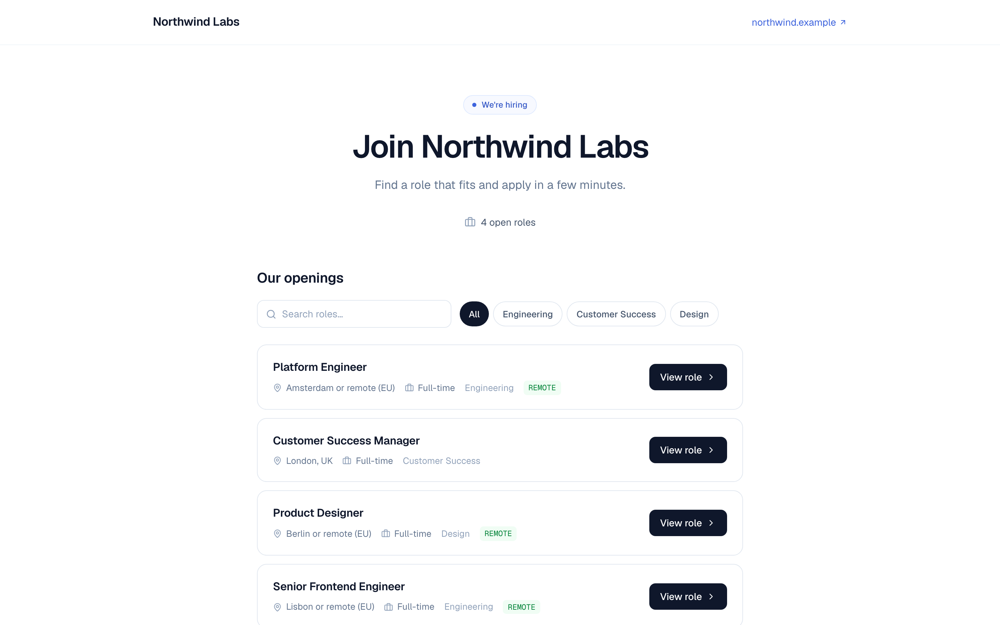
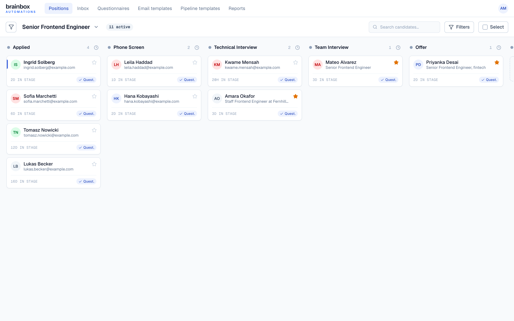
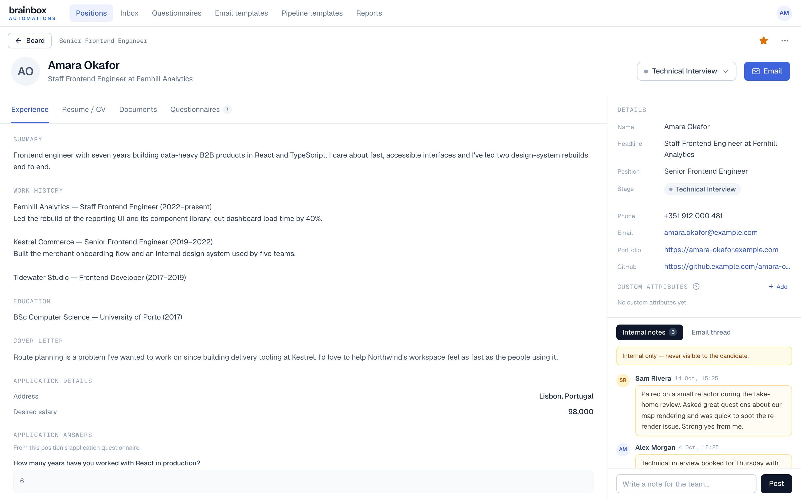
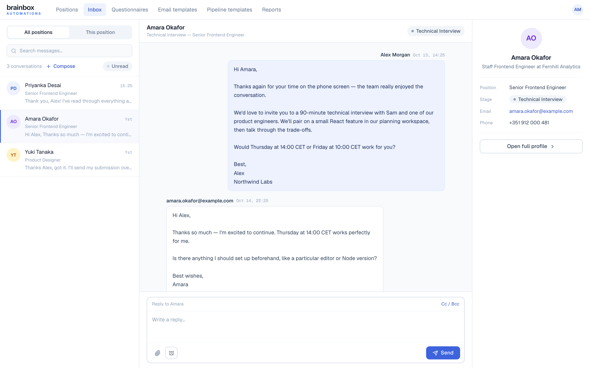
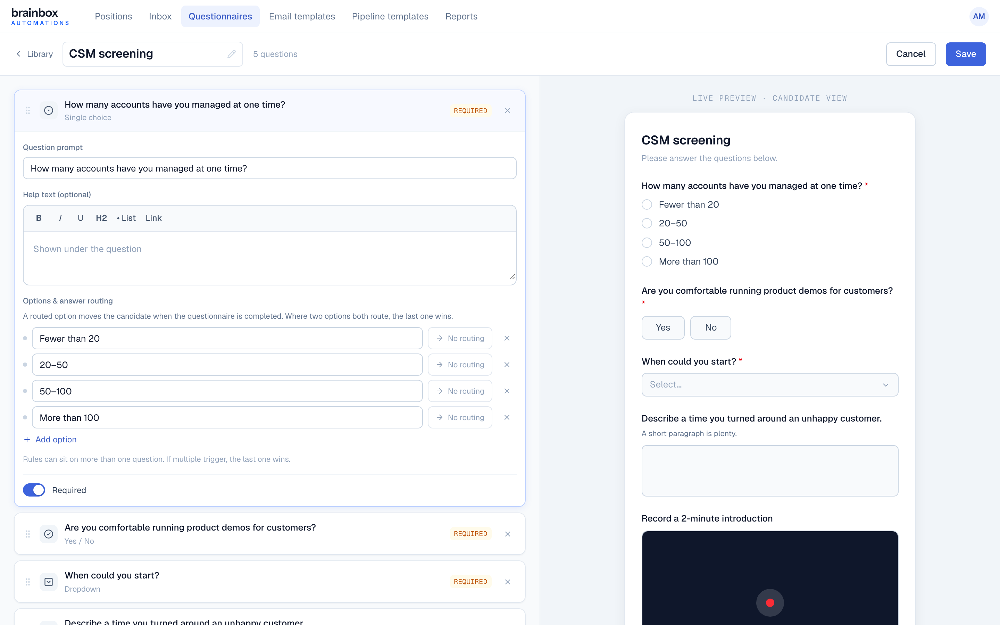

# openHR

An applicant tracking system for one hiring team: public careers pages,
pipelines, two-way candidate email, questionnaires and stage automation.
Open source and free to self-host.

[](LICENSE)

## What it is

openHR runs your company's hiring in one place. Candidates find open
roles on your careers pages and apply; your team moves them through a pipeline,
emails them from the app, sends questionnaires and lets each stage do its own
follow-up.

One deployment serves one company. Every signed-in user is a member of the
hiring team and sees everything; there are no roles or per-client accounts.
You run it yourself, on your own Supabase project and any host that runs a
Next.js app, so your candidate data stays in your accounts.

## Screenshots

All screenshots use demo data for a fictional company, Northwind Labs.



*The public careers page, under the hiring company's own name and logo.*



*A position's board: candidates in columns by pipeline stage.*



*A candidate profile: experience, résumé preview, notes and the email thread.*



*Two-way email with candidates, in a shared Inbox.*



*The questionnaire builder, with answer routing and a live preview.*

## Features

- **Positions** with a five-step wizard, listed / unlisted / disabled on the
  public careers site, and a pipeline of stages frozen once the position goes
  live.
- **Public apply form** with résumé upload, an optional application
  questionnaire, and video answers recorded in the browser or pasted as a link.
- **Board** per position: drag between stages, filters, star, bulk move /
  archive / export / email / send questionnaire.
- **Candidate profile**: experience, résumé preview (PDF, Word .docx, images),
  documents, questionnaires, notes, custom attributes, email thread.
- **Stage automation**: when a candidate first enters a stage, send an email,
  send a questionnaire (with reminders) or move them on, each after its own
  delay. Leaving the stage before the delay cancels what's pending.
- **Questionnaires**: ten question types, single-use emailed links, reminders
  until completed, and moving the candidate by answer or on completion.
- **Email**: two-way threaded email with templates, merge variables, CC / BCC,
  attachments and scheduled send; replies arrive in a shared Inbox.
- **Spam protection** on the public forms: rate limits in the database and an
  optional Cloudflare Turnstile captcha.
- **Slack**: a notification when a candidate replies, with their stage.
- **Reports** and **Settings** (team members, email, Slack).

## Stack

Next.js 16 (App Router) · React 19 · TypeScript · Tailwind · Supabase
(Postgres, Auth, pg_cron, pg_net) · Cloudflare R2 (file storage) · Resend
(email) · Slack (optional) · Cloudflare Turnstile (optional)

## Quick start for local development

You need Node.js 22, npm 10, Docker and the
[Supabase CLI](https://supabase.com/docs/guides/local-development/cli/getting-started).
Use npm, not pnpm or yarn.

```bash
cd frontend
npm ci
npm run db:start                         # local Supabase with every migration and sample data
node ../scripts/local-supabase-env.mjs   # prints the local URL and keys
cp .env.example .env.local               # paste in the values printed above
npm run dev
```

Staff sign in at http://localhost:3000/admin; the root opens the public careers
page. [docs/development.md](docs/development.md) has
the details: which values to set, creating your first local user, every
command, the git hooks, schema changes and the test suites.

## Self-hosting

To run your own copy for real hiring, follow
**[docs/self-hosting.md](docs/self-hosting.md)**: Supabase, migrations, Auth
settings, file storage, email, the automation worker, hosting, upgrades and the
full list of environment variables.

## Testing

Four automated layers run in CI on every push and pull request: unit (L1) and
component (L2) tests with Vitest, API integration tests (L3) against a real
Supabase, and pgTAP database tests (L4) covering the row-level security that
is the app's whole authorisation model. L3 and L4 run against a throwaway local
Supabase stack, so they need no account or secrets:

```bash
cd frontend
npm run test:run                  # L1 and L2
npm run db:start
npm run test:integration:local    # L3
npm run test:db:local             # L4
npm run db:stop
```

See [docs/testing-strategy.md](docs/testing-strategy.md) for what each layer
covers, and [docs/testing-checklist.md](docs/testing-checklist.md) for the
manual QA plan.

## Documentation

[docs/README.md](docs/README.md) is the index: architecture, development,
self-hosting, deployment and testing.

## License

openHR is **open source** under the [MIT License](LICENSE). Anyone may
use, modify, self-host, distribute and build on it, including commercially,
with no restriction on competing uses. The BrainBox name and logo are not
covered by the license; see [TRADEMARKS.md](TRADEMARKS.md).

## Contributing

Contributions are welcome. Before your first pull request is merged you sign
the [Contributor License Agreement](CLA.md); a bot walks you through it on the
pull request. Read [CONTRIBUTING.md](CONTRIBUTING.md) for setup, the rules for
migrations and how pull requests are reviewed, and follow the
[Code of Conduct](CODE_OF_CONDUCT.md).

## Security

Please don't report security problems in public issues. See
[SECURITY.md](SECURITY.md) for how to report one privately.

## Custom version

If you want a customized version of this app for your organization . Feel free to contact Brainbox at
[brainboxautomations.com](https://www.brainboxautomations.com/contact) for more information.

---

Made by [BrainBox Automations](https://www.brainboxautomations.com).
